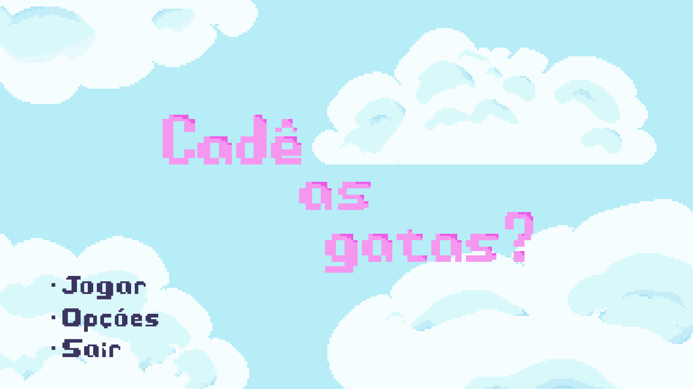
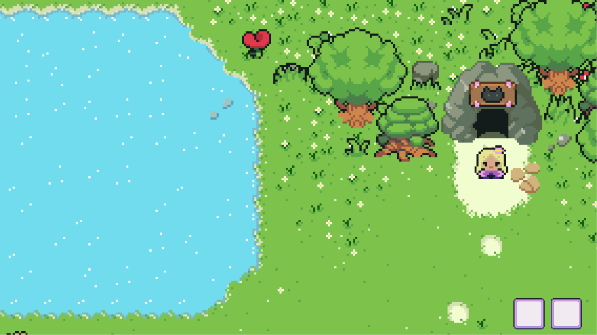
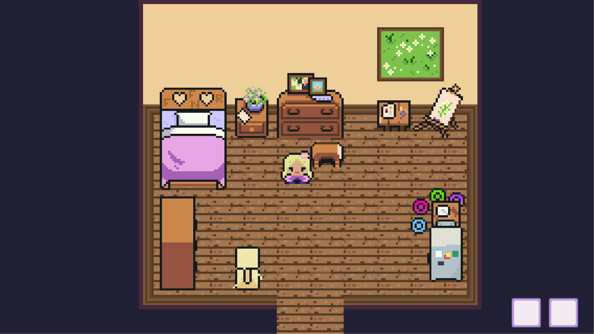

# Cadê as Gatas (Where Are the Kitties)

Top-down 2D adventure game made in Unity 6 (C#), developed in 2026 as a personal project. The story, characters, setting, objectives, and ending are original. The base systems were built by following tutorials, as described below.

### Main menu

### Gameplay #1

### Gameplay #2

## Story

The player's cats have gone missing. The goal is to find all of them and go back home to finish the game. The game takes about 15 minutes to complete.

## Features

- Main menu with Play, Options (volume), and Quit
- Intro and final cutscenes built with Unity Timeline
- Loading screen with scene transitions
- Dialogue system for NPCs and for the player's own speech
- Fetch and trade quests for each character, such as exchanging items for help
- Cats follow the player after their quest is completed
- Inventory and hotbar, chests, and collectible items
- Objectives page that strikes through completed quests
- Save system in JSON (position, map, inventory, chests, and NPC progress)
- Pause menu and sound effect library

## Controls

- **WASD**: move
- **E**: interact
- **1 / 2**: hotbar slots
- **Tab**: player menu

## What is mine and what came from tutorials

**From tutorials:** the UI, basic movement and interaction, navigation, inventory, and save system. I used these as a base and adapted them to this game.

**Made by me:** the story, characters, dialogues, quests and their logic, NPC behavior (including followers), cutscenes, map layout, and the game design as a whole.

## Credits

- Tutorials: [Game Code Library, Full Top Down playlist](https://www.youtube.com/watch?v=HAVp6Z8b4xA&list=PLaaFfzxy_80HtVvBnpK_IjSC8_Y9AOhuP) and [Criando Games, NavMesh 2D tutorial](https://www.youtube.com/watch?v=zrFUl_jJQnA).
- Art: sprites for characters, objects, and environment are inspired by, and in many cases edited from, the [Ninja Adventure Asset Pack](https://pixel-boy.itch.io/ninja-adventure-asset-pack) by Pixel-Boy and AAA (CC0), recolored to fit the game's palette. Some sprites were drawn from scratch.

## Technologies

- Unity 6 (6000.3.8f1)
- C#
